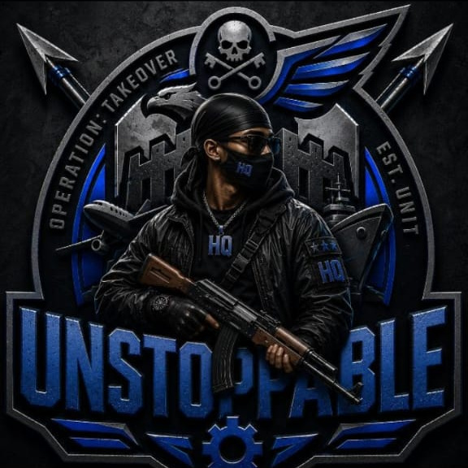

  <h1>Cyntron-X</h1>
  

  

---

  

---

> Quick Actions

| Action | Link |
|--------|------|
| **Fork Repository** |  |
| **Download ZIP** |  |

---

> 🌐 Deployment Options

| Platform | Button |
|----------|--------|
| **Heroku** |  |
| **Railway** |  |
| **Render** |  |
| **CypherXHost** |  |

---

> 🔑 Session & Pairing

| Method | Button |
|--------|--------|
| **Pair Code** |  |
| **QR Code** |  |

---

> 💬 Support

| Platform | Link |
|----------|------|
| **Issues** |  |
| **Owner WhatsApp** |  |

---

  Built by <a href="https://github.com/mgazah">UNSTOPPABLE</a>

